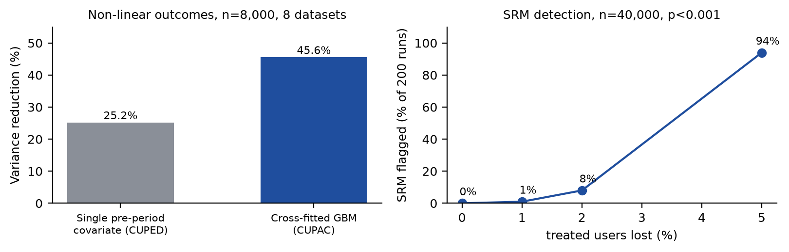

```{=typst}
#set text(hyphenate: false)
#set bibliography(title: "References")
#show cite: set text(fill: rgb("#1f4e9e"))
#show bibliography: set par(justify: false)
// Three-rule tables (top, below header, bottom) and bold "Figure N" / "Table N" labels
#set table.hline(stroke: 0.6pt)
#show table: it => box(stroke: (top: 1pt, bottom: 1pt), it)
#show figure.caption: it => context [#strong[#it.supplement~#it.counter.display(it.numbering)#it.separator]#it.body]
#show table: set par(justify: false)
#show heading.where(level: 1): it => block(above: 1.2em, below: 0.6em)[
  #set text(fill: rgb("#1f4e9e"), size: 14pt, weight: "bold")
  #it
]
#show heading.where(level: 2): set text(fill: rgb("#2d2d2d"), size: 11.5pt)
#let glance(body) = block(fill: rgb("#eef3fb"), stroke: (left: 3pt + rgb("#1f4e9e")), inset: 10pt, radius: 2pt, width: 100%, body)
// Header: red title, subtitle, author, repository link
#align(center)[
  #set par(justify: false)
  #text(size: 17pt, weight: "bold", fill: rgb("#b91c1c"))[Online Experimentation Platform]
  #v(0.5em)
  #text(size: 12pt, weight: "bold")[Design, monitor and analyse A/B tests without fooling yourself: peeking-safe, variance-reduced, validated on simulated ground truth]
  #v(0.9em)
  #text(size: 11pt)[Reagan Kesseku, Ph.D.]
  #linebreak()
  #text(size: 10pt)[#link("https://github.com/rkesseku/experimentation-platform")[github.com/rkesseku/experimentation-platform]]
  #v(0.45em)
  #text(size: 9.5pt)[#emph[Keywords:] A/B testing; online controlled experiments; CUPED; sequential testing; sample ratio mismatch]
]
#v(0.5em)
```

```{=typst}
#glance[
*At a glance* \
*Problem:* Most A/B-testing mistakes are procedural, not arithmetic: stopping when a dashboard first shows p < 0.05, trusting results from broken randomisation, testing many metrics at once, and wasting sample. \
*What I built:* A Python library, FastAPI service and Streamlit dashboard that turn raw experiment events into one trustworthy readout: sample-size design, deterministic assignment with sample-ratio-mismatch (SRM) checks, variance-reduced effect estimates, multiplicity control, guardrail tests, anytime-valid sequential monitoring and segment effects. \
*Headline result:* With no true effect and 50 looks at nominal 5%, naive peeking produces false positives in *32.2%* of simulated experiments; the platform's sequential methods hold it at *1.7%* (mSPRT) and *4.8%* (O'Brien-Fleming). CUPED/CUPAC cut metric variance by *26.5%* to *45.6%*. All data are simulated, and the 55 tests check each claim against known ground truth. \
*Stack:* Python, NumPy/SciPy/pandas, scikit-learn, FastAPI, Streamlit, pydantic, pytest \
*Repo:* #link("https://github.com/rkesseku/experimentation-platform")[github.com/rkesseku/experimentation-platform]
]
```

# The problem

An A/B test randomly splits users into a *control* group and a *treatment* group (for example, the old and new checkout page) and compares an outcome such as revenue per user. The arithmetic of the comparison is easy. What goes wrong in practice is the process around it, and each failure produces confident-looking but wrong decisions:

- **Peeking.** Teams watch a live dashboard and stop the moment the result looks significant. Each extra look is another chance for noise to cross the threshold; with 50 looks at a nominal 5% level, the real false-positive rate is about one in three.
- **Broken randomisation.** A logging bug that silently drops 3% of treated users barely moves the average effect yet invalidates it. A free statistical check (SRM) catches this, but only if someone runs it.
- **Wrong variance.** Ratio metrics such as revenue per session violate the independence assumption of a naive t-test, and heavy-tailed metrics make it under-powered.
- **Many metrics, one story.** Ten metrics tested at 5% give roughly a 40% chance of at least one spurious "win".
- **Wasted sample.** Pre-experiment behaviour predicts much of the outcome, and a well-designed analysis can use it to shrink noise and reach a decision with fewer users.

This project packages the standard statistical countermeasures behind one readout, so that the safe path is also the default path. It is a portfolio project: all data are generated by a simulator with *known* true effects, which makes it possible to test the methods rather than merely apply them.

# Approach

## How a readout is produced

1. **Design.** Size the test from the metric's variance, the target effect and, optionally, the share of variance a pre-period covariate explains.
2. **Assign and audit.** Hash each unit into a stable bucket, then test arm counts against the intended split (SRM) and re-derive every variant from the hash. A failure marks the readout `invalid_srm` and withholds any ship decision.
3. **Estimate.** Variance-reduced effects with confidence intervals, multiplicity-corrected across metrics, plus non-inferiority tests for guardrails.
4. **Monitor and explain.** Optional anytime-valid sequential monitoring of the primary metric, and per-segment effects with an omnibus heterogeneity test.

## Architecture

{#fig-arch width=80%}

Each statistical concern lives in one module with its own tests; the simulator doubles as the test oracle.


# Methods and design decisions

**Sample size with covariates.** For a mean difference $\delta$ with standard deviation $\sigma$ and covariate $R^2 = r$, the per-arm size scales by $(1 - r)$, so a pre-period covariate that explains 25% of variance shrinks the required sample by a quarter. Proportions use the pooled-null/unpooled-alternative formula, and minimum detectable effect solves the exact power function. *Why:* it makes the payoff of variance reduction visible at planning time, not only after the fact.

**Hash-based assignment and SRM.** The unit's position $u$ (the first 8 bytes of SHA-256 of "salt:unit", divided by $2^{64}$) is compared with cumulative variant weights. A *layer* gives each experiment a disjoint range of 10,000 buckets, enabling mutual exclusion; different layer salts give independent experiments. SRM [@fabijan2019] is a chi-square goodness-of-fit test flagged at $p < 0.001$. *Why:* deterministic hashing needs no assignment table and is reproducible; the strict threshold keeps false alarms near zero.

**Effect estimation.** Welch's t-test (Satterthwaite degrees of freedom) and a two-proportion z-test cover the basics. Ratio metrics $R = \sum N / \sum D$ use the delta-method variance [@deng2018delta], which accounts for the correlation between numerator and denominator within a user. *CUPED* [@deng2013cuped] adjusts the outcome by $\theta (X - \bar{X})$ with a pre-experiment covariate $X$; because $X$ is measured before treatment it adds no bias, and variance shrinks by roughly $\rho^2$. *CUPAC* replaces $X$ with a cross-fitted gradient-boosting prediction from several pre-period features, capturing non-linear structure; cross-fitting prevents the model from leaking the outcome. Bootstrap (percentile, BCa) is available for heavy tails.

**Multiplicity and guardrails.** Holm's procedure for the family-wise error rate [@holm1979] or the Benjamini-Hochberg procedure for the false discovery rate [@benjamini1995] is applied across primary and secondary metrics. Guardrails (for example latency) use one-sided non-inferiority tests against a margin; claiming "all guardrails pass" is an intersection-union statement and needs no further correction.

**Sequential monitoring.** Two complementary tools are provided. The *mSPRT* [@johari2017] places a normal mixing prior on the effect; the resulting likelihood ratio is a non-negative martingale under the null, so by Ville's inequality the probability it ever reaches $1/\alpha$ is at most $\alpha$. This yields always-valid p-values and a confidence sequence [@howard2021] that stays valid however often it is checked. For a planned number of looks, *Lan-DeMets O'Brien-Fleming* boundaries are computed by numerical integration of the surviving Brownian-motion density: demanding early on (z = 4.38 at 20% of the data) and close to the fixed-horizon value at the end (z = 2.06). *Why both:* mSPRT supports continuous peeking at a cost in power; group-sequential designs are more powerful when looks are planned.

**Heterogeneity.** Per-segment Welch effects are multiplicity-corrected and accompanied by Cochran's Q omnibus test. A cross-fitted T-learner estimates conditional effects, and units are grouped into out-of-fold effect quantiles whose *realised* effect is measured with an ordinary randomised comparison, which shows whether the model found real heterogeneity rather than noise.

# Results

All figures below come from `examples/reproduce_results.py` (outputs in `examples/results.json`) or from `build_readout` on the demo scenario, run with the seeds stated. Data are simulated.

## Peeking: why sequential methods matter

{#fig-peek width=92%}

With no true effect, a single fixed-horizon look gives 0.049, naive peeking 0.322, mSPRT (mixing sd 0.2) 0.017 and O'Brien-Fleming with 5 looks 0.048. When the variance is re-estimated at every look from raw data (30 looks, 1,000 simulations) the pattern holds: fixed 0.062, naive 0.297, mSPRT 0.022, O'Brien-Fleming 0.054. With a true effect of 0.1 sd, power is 0.999 (fixed), 0.982 (mSPRT) and 0.999 (O'Brien-Fleming), and mSPRT stops on average after 36% of the maximum sample among rejecting runs. This is the price of validity: mSPRT is conservative, here 0.017 against the nominal 0.05.

## Variance reduction and data-quality checks

{#fig-cuped width=88%}

On 500 simulated experiments (n = 2,000, true effect 0.4, outcome-covariate correlation 0.5) the mean CUPED estimate was 0.405 against 0.401 unadjusted (Monte-Carlo se 0.003), so no detectable bias. The variance ratio was **0.735** against the theoretical $1 - \rho^2 = 0.75$, a 26.5% reduction. With non-linear outcomes a gradient-boosting CUPAC covariate reached **45.6%** against 25.2% for a single pre-period covariate. The SRM check raised no false alarms with no loss and flagged 1%, 8% and 94% of runs at 1%, 2% and 5% loss; small losses are genuinely hard to detect at this sample size, so SRM is a screen rather than a guarantee.

## Calibration against ground truth

Welch type-I error under the null was 0.0472 (5,000 simulations, 200 per arm, unequal variances). At the calculator's n = 566 per arm ($\delta$ = 0.5, sd = 3, target power 0.80) simulated power was 0.802 (3,000 simulations). Delta-method 95% intervals for a ratio-of-means effect covered the truth 0.9485 of the time (2,000 simulations). Sizing examples: $\delta$ = 0.2 sd needs 393 per arm, or 295 with $r^2$ = 0.25; a 10% to 12% conversion lift needs 3,841 per arm.

## End-to-end readout

Simulated "checkout redesign" (n = 40,000, seed 7) with segment effects of +0.15 (A) and -0.25 (C) added to the true lift. I re-ran `build_readout` for this brief; it matches the README.

{#fig-readout width=74%}

The primary effect is +0.317 (95% CI 0.250 to 0.385) after CUPED, which removed 24.7% of the variance; SRM $p$ = 0.418. The mSPRT confidence sequence first excludes zero at n = 4,000 of 40,000, and all five O'Brien-Fleming checkpoints are crossed. Segments A and B are significant after Holm correction while C is not. Cochran's Q across segments gives $p$ = 5e-7, flagging real heterogeneity. Re-running the same data with 3% of treated users removed trips the SRM check ($p$ = 1.3e-4 in the README run) and the status becomes `invalid_srm`.

# What this demonstrates

- **Statistical judgement beyond running a t-test:** choosing the right variance for ratio metrics, controlling error under continuous monitoring, and knowing when a result should not be trusted at all.
- **Validation discipline:** every method is checked against a simulator with known truth (type-I error, power, coverage, bias, boundary error rates), using fixed seeds and stated Monte-Carlo tolerances in 55 tests.
- **Engineering around the statistics:** a typed configuration layer (pydantic), a stateless-looking REST API (`POST /experiments`, `/events`, `GET /analysis`, `/design/sample-size`, `/assign/{unit}`), an interactive dashboard with an SRM-bug toggle, and a reproducible results script.
- **Honest reporting:** conservative methods are labelled conservative, and a screening check is not presented as a guarantee.

# Limitations and next steps

**Limitations.**

- Two-arm experiments only (control plus one treatment); multi-arm designs would need a family-wise adjustment over arms.
- Unit-level randomisation with independent units: no cluster or network interference, no switchback designs.
- The service keeps state in memory in one process and has no authentication; `Store` would be swapped for a database to persist.
- The sequential simulations assume normal data; with heavy tails and small samples, the plug-in variance is only asymptotically valid.
- mSPRT is conservative (0.017 against nominal 0.05) and the mixing standard deviation $\tau$ affects power. The default in the readout is 0.1 times the metric sd unless pre-specified.
- The T-learner validates ranking quality, not causal identification beyond randomisation. All results are on simulated data; I have not validated against production experiments.

**Next steps.** Multi-arm support with a family-wise adjustment, a persistent store with authentication, cluster-robust and switchback analyses, and always-valid methods that handle heavy-tailed data without a normality assumption.

# How to run it

```
pip install -e ".[dev,dashboard]"          # add ",econml" for the EconML backend
pytest -q                                   # 55 tests, about 40-60 s
python -m expplatform.demo                  # text readout on simulated data
streamlit run src/expplatform/dashboard.py  # dashboard (toggle an SRM bug in the sidebar)
uvicorn expplatform.api:app --reload        # API docs at http://127.0.0.1:8000/docs
python examples/reproduce_results.py        # regenerate the Results numbers (~75 s)
```

Brief figures can be regenerated with `docs/brief/make_figures.py` (set `PYTHONPATH=src`).
